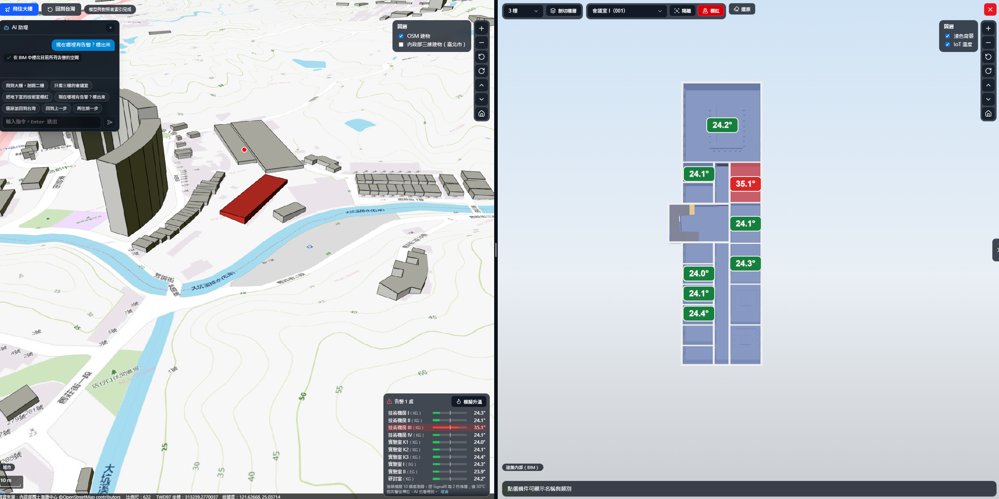
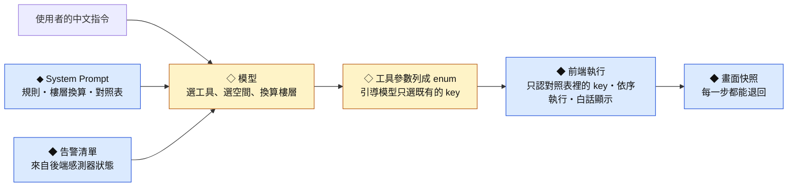
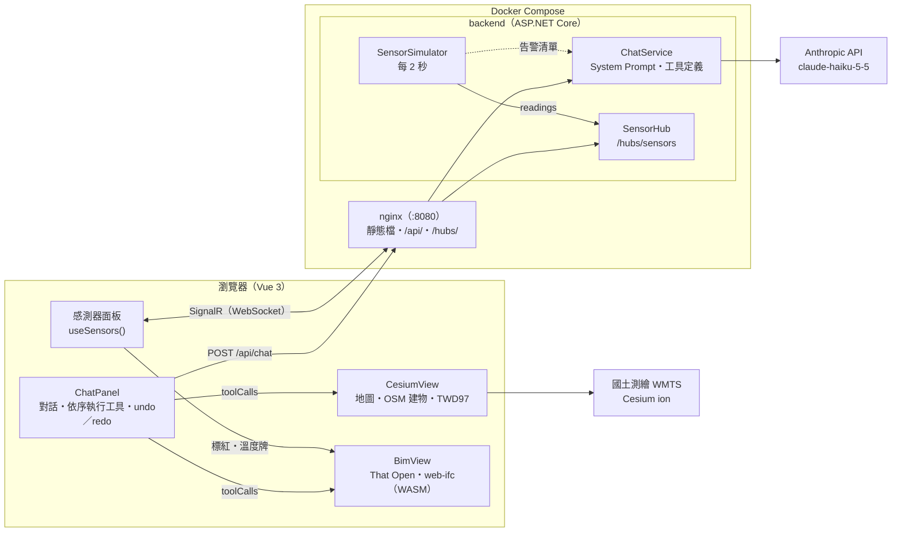
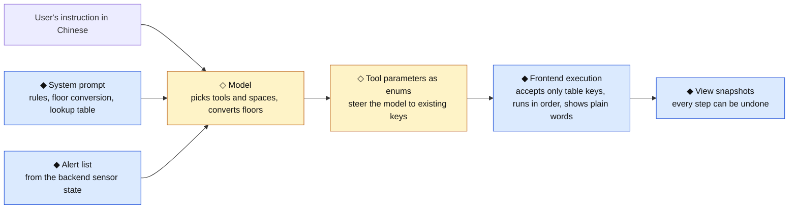
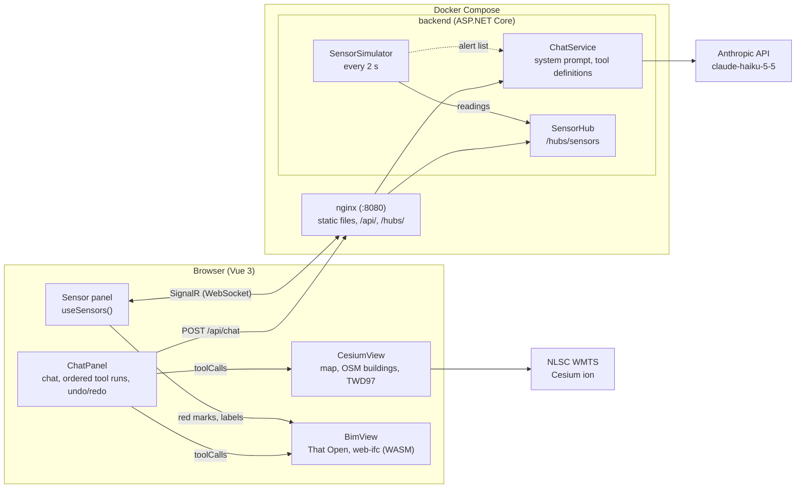

# AI 空間智慧數位雙生戰情室

[](https://github.com/Rocky1987/spatial-agent-twin/actions/workflows/ci.yml)

**中文** | [English](#english)

用中文對 AI 下指令，畫面就從台灣地圖飛進一棟建築，剖開樓層、找到房間。建築裡模擬的溫度感測器每 2 秒更新一次，超過門檻的房間自動標紅；問 AI「哪裡有告警」，它也答得出來。



## 這是什麼

一棟建築的資料通常分散在不同地方：位置在地圖上，樓層與房間在 BIM 模型裡，溫度在監控系統裡。要回答「三樓的廁所在哪裡」「現在哪個房間過熱」，得在幾套軟體之間切換，還要會操作 3D 檢視器。

這個專案把三者放進同一個畫面：左邊是台灣的 3D 地圖，右邊是建築內部的 BIM 模型，角落是感測器面板。操作方式是直接用中文說，例如：

- 「帶我去研究所大樓」
- 「剖切到 2 樓」
- 「幫我隔離 3 樓的廁所」
- 「現在哪裡有告警？標出來」
- 「請帶我看技術機房，並幫我剖切到該樓層」

它的特色：

- **用說的就能操作 3D。** 不必會用 BIM 檢視器。一句話可以包含好幾個動作，系統依序執行，每一步都用白話列在對話窗。
- **從城市到房間。** 先在地圖上飛到目標大樓，再展開建築內部，剖切樓層、隔離房間、標紅。地圖一直留在左邊，兩個窗格可以拖曳調整寬度。
- **感測資料即時推播。** 後端模擬 10 個溫度感測器，每 2 秒經 SignalR 推給所有開著的畫面；達 30°C 就告警，房間標紅，BIM 裡的溫度牌變紅。
- **AI 回答的告警和畫面上的是同一份。** 告警清單由後端的感測器狀態提供，不是模型自己猜的。
- **說錯了可以退回。** 說「回到上一步」可以一路退回最初，說「再往前一步」就取消退回。
- **台灣的坐標與圖資。** 底圖是國土測繪中心的臺灣通用電子地圖，滑鼠所在位置即時換算成 TWD97 坐標。
- **一行指令啟動。** 有 Docker 就能跑，LLM 金鑰只放在後端容器，不進前端。

> 網頁沒有登入與速率限制，連得到網頁的人都能用你的金鑰呼叫模型。請只在本機展示，不要對外公開。見[已知限制](#已知限制)。

## 快速開始（Docker）

只需要 Docker（Compose v2），不必安裝 Node 與 .NET。

```bash
cp .env.example .env      # 填入 ANTHROPIC_API_KEY；VITE_CESIUM_ION_TOKEN 選填
docker compose up --build
```

建置完成後開啟 <http://localhost:8080>。

- **`ANTHROPIC_API_KEY`**：AI 對話需要。沒填時地圖、BIM 與感測器照常運作，只有對話窗會回「後端沒有設定 Anthropic:ApiKey」。
- **`VITE_CESIUM_ION_TOKEN`**：[Cesium ion](https://ion.cesium.com/) 的 token，用來載入 OSM 3D 建物與地形。沒填也能跑，只是地圖上沒有 3D 建物與地形（目標大樓仍有標記點）。這支 token 會打包進前端 JS，所以請另建一支只開 `assets:read` 的 token，並在 Allowed URLs 限定 `http://localhost:8080`。
- **兩個容器**：`frontend` 是 nginx，提供靜態檔，並把 `/api/` 與 `/hubs/`（WebSocket）轉給 `backend`；`backend` 是 ASP.NET Core，只在 Compose 的內部網路開放。
- **連接埠**：只綁 `127.0.0.1:8080`（網頁沒有登入，且會用你的金鑰呼叫模型），衝突時改 `docker-compose.yml` 的 `ports`。

## 試著說說看

開啟網頁後，點對話窗下方的快捷指令，或自己輸入：

| # | 說法（例） | 預期畫面 |
|---|---|---|
| 1 | 帶我去研究所大樓 | 地圖飛到大樓上空，右側展開 BIM 窗格 |
| 2 | 剖切到 2 樓 | 隱藏上方樓層，露出 2 樓平面（模型裡的 1. Obergeschoss） |
| 3 | 幫我隔離 3 樓的廁所 | 只顯示 3 樓的男廁與女廁，相機對準 |
| 4 | 現在哪裡有告警？標出來 | AI 說出告警的房間與溫度，BIM 隔離並標紅這些房間 |
| 5 | 請帶我看技術機房，並幫我剖切到該樓層 | 一句話完成三步：飛到大樓、剖切地下室、隔離 4 間技術機房 |

- **情境 沒有告警時**，先按感測器面板的「模擬升溫」，等幾秒溫度升過 30°C 再問。


## 概念說明

### 什麼是數位雙生

數位雙生（Digital Twin）是在電腦裡為一個實體（一台設備、一棟建築、一座城市）建立的分身，而且實體的狀態會持續流進分身，讓分身反映實體**現在**的樣子。它和一般 3D 模型的差別不在畫面多精美，而在**資料有沒有自動連動**。

常見的分類依資料流向分成三級（Kritzinger 等人，2018）：

| 等級 | 實體 → 數位 | 數位 → 實體 | 例子 |
|---|---|---|---|
| 數位模型（Digital Model） | 手動 | 手動 | 一份 BIM 檔，現場改了要有人去改檔 |
| 數位影子（Digital Shadow） | 自動 | 手動 | 監控畫面：感測數據自動更新到模型上，要不要處理由人決定 |
| 數位雙生（Digital Twin） | 自動 | 自動 | 分身算出的結果自動回寫，調整實體設備 |

**本專案的位置：** 感測資料（由模擬器代替實體）自動流進畫面，但不回寫任何設備，所以嚴格說是**數位影子**的展示原型。不做回寫是刻意的：在展示原型裡讓 AI 碰得到設備，風險遠大於價值。

### 本專案怎麼實現

一棟建築的數位雙生要回答的問題，可以拆成五層：

| 層 | 回答的問題 | 本專案的做法 |
|---|---|---|
| 地理 | 它在哪裡？周圍是什麼？ | Cesium 3D 地球，疊上國土測繪中心的電子地圖、OSM 3D 建物與地形；滑鼠位置換算成 TWD97 坐標 |
| 建築 | 它長什麼樣？有哪些樓層、房間？ | IFC 模型（營建業的開放標準格式）直接在瀏覽器解析與顯示，可剖切樓層、隔離房間、標紅 |
| 語意 | 「三樓的廁所」是模型裡的哪幾個物件？ | 一份對照表：5 個樓層、26 間空間，每筆有短代號（key）、IFC 的 GlobalId、中文名與常見說法 |
| 狀態 | 它現在怎麼樣？ | 後端模擬 10 個溫度感測器，掛在對照表的空間上，每 2 秒推播一次；達 30°C 告警 |
| 互動 | 我要怎麼問、怎麼看？ | 用中文對 AI 說，AI 把話轉成操作畫面的指令 |

**這五層靠對照表的 key 串在一起。** 感測器掛在空間的 key 上，AI 下指令時的參數也是 key，BIM 再用 key 查到 GlobalId，找到模型裡的構件。地圖負責「在哪裡」，BIM 負責「長怎樣」，感測器負責「現在如何」；AI 不提供新的資料，它讓人不必學操作就能用上前面三層。

### 從一句話到畫面

以「請帶我看技術機房，並幫我剖切到該樓層」為例：

1. **你用中文說。** 對話窗把這句話和先前的對話送到後端。
2. **後端補上背景資料。** 規則、樓層換算、對照表全文，以及後端感測器此刻的告警清單，一起交給模型。
3. **模型決定要做哪些動作。** 它回傳一串有順序的指令：飛到大樓 → 剖切地下室 → 隔離 4 間技術機房。參數只能從對照表裡選。
4. **前端依序執行。** 前一個動作完成（例如飛行結束）才做下一個；每一步用白話列在對話窗，做完打勾，失敗就標紅並停下。
5. **每一步都可以退回。** 執行前先存一份畫面狀態，說「回到上一步」就還原。

感測器的告警走另一條路，不經過 AI：

1. 後端每 2 秒更新 10 個溫度，經 SignalR 推撥給所有開著的畫面。
2. 溫度達 30°C，**程式**就把房間標紅、在面板列出，並把溫度牌變紅。門檻是寫在程式裡的數字，不是 AI 判斷的。
3. 你問「哪裡有告警」時，後端把同一份告警清單附給模型，模型照清單回答。

### 工業級精度與本專案規格的差別

這裡的「工業級」指製造業與工廠（產線、設備）用的數位雙生；「工程級」指營建工程與設施管理用的建築數位雙生（BIM 加上建築自動化系統）。本專案的題材屬於後者，但精度只有展示級。

| 面向 | 工業級（製造、廠區） | 工程級（建築、設施管理） | 本專案（展示原型） |
|---|---|---|---|
| 主要用途 | 產線與設備的即時監控、預測性維護、製程最佳化 | 設計、施工、竣工交付，以及之後的設施管理 | 展示「中文 → 畫面操作」與「感測 → 告警 → AI 解說」的流程 |
| 幾何精度 | 依製造公差，零件可到毫米以下 | 依模型細緻度（LOD）分級，竣工階段（LOD 500）要求與現場量測一致，常以雷射掃描點雲比對 | 德國 KIT 公開的示範模型，與台灣任何建築無關，未經量測驗證 |
| 定位 | 廠內坐標系，對齊設備與產線 | IFC 帶地理參考（`IfcMapConversion`），以測量控制點套到 TWD97 等國家坐標 | **沒有錨定。** 地圖上的「研究所大樓」是台北一棟 OSM 建物當替身；BIM 在獨立窗格，沒有放進地圖 |
| 感測資料 | 真實感測器，毫秒到秒級，經 OPC UA、MQTT、Modbus 等協定接入，有校正與時間戳，存進時序資料庫 | 建築自動化系統（BACnet 等）的空調、電力、門禁點位，常見為秒到分鐘級 | 後端亂數模擬 10 個溫度點，每 2 秒一筆，不存歷史，沒有校正與缺值處理 |
| 分析 | 物理模擬、異常偵測、剩餘壽命預測 | 能耗分析、維護排程、空間使用率 | 只有固定門檻（30°C） |
| 回寫控制 | 經 PLC／SCADA 回寫設定值，要有連鎖保護與功能安全 | 經建築自動化系統調整空調、照明等設定值 | **不回寫。** AI 只能動畫面 |
| 相關標準 | ISO 23247（製造業數位雙生框架）、OPC UA（IEC 62541）、IEC 62443（工控資安） | IFC（ISO 16739-1）、ISO 19650（BIM 資訊管理）、BACnet（ISO 16484-5） | 讀 IFC4 格式，其餘未涵蓋 |
| 可靠度與資安 | 備援、稽核、網段隔離 | 權限、版本控管、共通資料環境（CDE） | 沒有登入、稽核與速率限制，只適合本機展示 |

一句話總結：**本專案用的是工程級的資料格式，精度是展示級。** IFC 是營建業的開放標準，TWD97 用的是正式的坐標定義（EPSG:3826），但模型、位置與感測資料都不是量測來的。

它要證明的是「各層接得起來」：地理、建築、語意、狀態與 AI 之間的介面走得通，換成真實資料時這些介面不必改。要往工程級走，需要補的是：

| 要補什麼 | 做法 |
|---|---|
| 真實位置 | 在 IFC 補地理參考（例如用 Bonsai 設定 `IfcMapConversion`），以控制點錨定到 TWD97，再把 BIM 轉成 3D Tiles 或 glTF 放進地圖 |
| 真實模型 | 換成實際建築的竣工模型，或用點雲比對現況 |
| 真實感測 | 接感測閘道（MQTT、BACnet），存進時序資料庫，補上資料品質旗標與校正 |
| 對照表 | 由 IFC 自動同步 key 與 GlobalId，不靠手寫 |
| 坐標驗證 | TWD97 換算與官方控制點比對（目前用 proj4 換算，尚未比對） |
| AI 驗證 | 建立自動化評測題庫，量出選錯工具或空間的比例 |

### AI 怎麼介入、扮演什麼角色

**AI 是操作介面，不是資料來源，也不是判斷者。** 它負責把人說的話轉成畫面操作；溫度從哪裡來、幾度算告警、有哪些房間，都由程式決定。

它扮演三個角色：

1. **翻譯：** 把口語中文轉成有結構的指令。「二樓」要換成元件 1. Obergeschoss（`OG1`），「技術機房」要對到 `Technikraum` 的 4 間房。
2. **調度：** 把一句複合指令拆成有順序的多個動作，例如先飛過去、再剖切、再隔離。
3. **解說：** 根據後端給的告警清單，用中文房名與溫度回答「哪裡有告警」；使用者要求標出來時，再呼叫標示告警的工具。

它不做、暫時也做不到的事：

- **不產生數據。** 溫度由後端模擬器產生，模型只讀得到附在請求裡的告警清單。
- **不判斷告警。** 30°C 門檻寫在程式裡；房間自動標紅是程式做的，AI 不在這條路上。
- **不直接控制相機。** 模型只能呼叫 8 個封裝好的工具（飛行、剖切、隔離、標紅、標示告警、還原、上一步、下一步），不能給座標或角度。
- **不碰任何設備。** 沒有任何寫入或控制的工具。

模型可能選錯工具或房間，所以把「靠程式保證」和「靠模型判斷」分開。下圖中 ◆ 是**確定性**的（由程式保證），◇ 是**機率性**的（靠模型，可能出錯）：



- **enum 不是保證。** 工具參數列成清單，是引導模型只從對照表裡選；後端沒有再驗證一次。保證來自前端：對照表裡找不到的 key 會被略過，不會動到別的構件；未知的工具名稱直接報錯。
- **選錯了看得到、也退得回。** 每個動作都列在對話窗（滑鼠移上去看原始參數），說「回到上一步」就還原。
- **只做單輪。** 前端執行完工具，不把結果送回模型，所以一句話只呼叫一次模型；代價是模型不知道動作成功與否，失敗時由前端直接告訴使用者。
- **用最便宜的模型。** 這類任務以選擇為主（從固定的工具與 key 中挑），預設用 `claude-haiku-5-5`；不穩時可以換成較大的模型。
- **正確率沒有自動化量測。** 目前只靠手動驗收，見[驗收狀態](#驗收狀態)。

## 技術細節

這一章給想看實作的工程師。

### 技術架構

| 層 | 位置 | 說明 |
|---|---|---|
| 前端 | `frontend/` | Vue 3 + TypeScript + Vite；CesiumJS（地圖）、That Open Components + web-ifc（BIM，以 WASM 解析 IFC）、Three.js；Tailwind CSS v4、reka-ui；`@microsoft/signalr`；proj4（TWD97） |
| 後端 | `backend/` | ASP.NET Core Minimal API（.NET 9）。`POST /api/chat` 以 `HttpClient` 直接呼叫 Anthropic Messages API（不用 SDK）；SignalR hub `/hubs/sensors` 與感測器模擬背景服務 |
| 閘道 | `frontend/nginx.conf` | nginx 1.27：靜態檔、`.wasm` 與 `.mjs` 的 Content-Type、`/api/` 與 `/hubs/`（WebSocket）反向代理、SPA 回退 |
| 部署 | `docker-compose.yml` | 兩個容器；金鑰從根目錄 `.env` 讀進 backend 的環境變數 |
| CI | `.github/workflows/ci.yml` | push 到 `main` 與 PR 時執行：前端 `npm run build`（含 `vue-tsc` 型別檢查）、後端 `dotnet build` |

元件與資料流：



### AI 工具與 System Prompt

System Prompt 有三部分：角色與規則、樓層換算、樓層與空間對照表全文，整段標記 `cache_control`（命中率未量測）。每次請求另外附上一段不快取的「目前的告警清單」，取自後端的 `SensorSimulator.Alerts()`，與推給前端的是同一份狀態。

| 工具 | 參數 | 前端做什麼 |
|---|---|---|
| `flyToLocation` | `place`：`institute`／`taiwan` | 飛到目標大樓上空並展開 BIM 窗格；或收合窗格、回到台灣全景 |
| `sectionStorey` | `key`：5 個樓層之一 | 隱藏上方樓層，在地板上方 1.2 m 剖切，相機轉成接近俯視（偏離垂直 25°） |
| `isolateSpaces` | `keys`：26 間空間 | 只顯示這些空間與所在樓層，房頂再剖一刀，以 40° 斜俯視對準 |
| `highlightSpaces` | `keys` | 標紅（每次先清掉舊標記） |
| `showAlerts` | 無 | 取目前告警的空間，隔離並標紅 |
| `resetView` | 無 | 取消剖切、隔離與標記 |
| `undo`／`redo` | 無 | 還原前端存的畫面快照 |

回應格式（示意，情境 5）：

```json
{
  "reply": "已飛到大樓，剖切地下室並隔離 4 間技術機房。",
  "toolCalls": [
    { "name": "flyToLocation", "args": { "place": "institute" } },
    { "name": "sectionStorey", "args": { "key": "KG" } },
    { "name": "isolateSpaces", "args": { "keys": ["KG-Technikraum-I", "KG-Technikraum-II", "KG-Technikraum-III", "KG-Technikraum-IV"] } }
  ]
}
```

### 實作上的幾個做法

- **地圖與 BIM 各用一個 WebGL 畫面，不做同畫面融合。** 兩個引擎的深度緩衝不共用，疊在同一畫面時遮擋關係會錯，所以改成左右雙窗格。Cesium 開 `requestRenderMode`，只在畫面變動時重繪。
- **BIM 延遲載入。** Institute 模型（10.9 MB，IFC4）在第一次展開 BIM 窗格時才載入，實測約 2 秒（含解析與建索引），不必先轉成 Fragments。
- **房間不在樓層的空間樹裡。** 這個模型的 `IfcBuildingStorey` 底下沒有 `IfcSpace`，所以「樓層 → 房間」改用對照表的 `storey` 欄位判斷。
- **模型座標與 IFC 標高差固定 +3 m。** 由各樓層房間的包圍盒反推，剖切面 = 地板 + 1.2 m（平面圖慣例）。
- **對照表只有一份正本。** `frontend/src/data/space-map.json` 由 `frontend/scripts/dump-ifc.mjs` 傾印 IFC 後手補中文；後端映像建置時複製同一份（環境變數 `SpaceMapPath`）。
- **TWD97 換算。** 用 proj4 與 EPSG:3826 的定義；先前手寫的公式和 proj4 在 2000 個隨機台灣座標上最大差 0.00001 m。比例尺分母以 OGC 的 0.28 mm 像素換算。兩者都以橢球面計算，不含地形高度。
- **溫度牌穿牆可見。** 每個感測器在房間中央放一個 canvas 貼圖的 sprite，關掉深度測試。
- **自動標紅只上色。** 告警變化時只改顏色，不動相機與可見性；只有 AI 的 `showAlerts` 會隔離並對準。曾因告警解除時自動還原視圖，相機被拉到整棟樓上方、只看得到屋頂，所以把兩者分開。
- **SignalR。** 連上時先送一份快照，之後每 2 秒推全部讀數；前端自動重連，後端還沒起來時每 3 秒重試。nginx 的 `/hubs/` 設了 WebSocket 升級標頭與 1 小時讀取逾時。
- **金鑰只在後端。** 前端打包產物搜不到 `sk-ant`、`x-api-key` 與實際金鑰字串（Cesium ion token 本來就放在前端，不在此限）。

### 專案結構

```text
spatial-agent-twin/
├─ frontend/
│  ├─ src/components/          CesiumView、BimView、ChatPanel、NavPanel
│  ├─ src/utils/               sensors.ts（SignalR）、twd97.ts（proj4）
│  ├─ src/data/space-map.json  樓層與空間對照表（前後端共用的正本）
│  ├─ scripts/dump-ifc.mjs     傾印 IFC 的樓層與空間
│  ├─ public/models/           KIT 的 IFC 模型
│  └─ Dockerfile、nginx.conf
├─ backend/
│  ├─ Program.cs               端點與服務註冊
│  ├─ ChatService.cs           System Prompt、工具定義、呼叫 Anthropic
│  ├─ Sensors.cs               感測器模擬與 SignalR hub
│  ├─ SpaceMap.cs              讀對照表
│  └─ Dockerfile
├─ docker-compose.yml
└─ spatial-twin-guard 實作進度.md
```

## 本機開發

以下是不用 Docker、直接在主機開發的步驟。只想看展示，用上面的快速開始即可。

需求：Node.js 22、.NET 9 SDK。

```bash
# 後端（http://localhost:5000）
dotnet user-secrets set "Anthropic:ApiKey" "<your key>" --project backend
dotnet run --project backend --launch-profile http

# 前端（另開一個終端機，http://localhost:5173）
cd frontend
cp .env.example .env    # 填入 VITE_CESIUM_ION_TOKEN（選填）
npm ci
npm run dev
```

- Vite 的 proxy 把 `/api` 與 `/hubs`（WebSocket）轉到 `localhost:5000`，開發時不必處理 CORS。
- **切勿提交金鑰。** 本機用 user-secrets，部署用環境變數 `Anthropic__ApiKey`；`.env` 已列在 `.gitignore`。
- 換模型：改 `backend/appsettings.json` 的 `Anthropic:Model`，或設環境變數 `Anthropic__Model`。
- 後端也可以用 Visual Studio 開 `backend/SpatialTwinGuard.slnx`。健康檢查是 `GET /api/health`。
- Cesium ion token 的 Allowed URLs 要包含 `http://localhost:5173`；5173 被佔用時 Vite 會改用 5174，也要一併加入。

## 驗收狀態

沒有自動化測試與評測，以手動驗收為主。每一步的紀錄見[實作進度](spatial-twin-guard%20實作進度.md)。

| 項目 | 狀態 |
|---|---|
| CI：前端 build（含型別檢查）、後端 build | 每次 push 執行 |
| 情境 1、2、3、5，各換 2–3 種說法 | 手動通過（開發版，2026-10-16） |
| 情境 4（告警） | 前端模擬版已手動測過；改成後端 SignalR 推播後，待瀏覽器驗收 |
| Compose 版重跑 5 個情境 | 待驗收 |
| 經 nginx 轉發的 `/api/chat` 與 SignalR、wasm 與 worker 的 Content-Type | 通過（以 curl 與 Node 用戶端測試，非瀏覽器） |
| 前端打包產物不含 LLM 金鑰 | 通過 |

## 已知限制

每條只列一句，細節見[實作進度](spatial-twin-guard%20實作進度.md)。

- **沒有座標錨定。** BIM 在獨立窗格，沒有放進地圖；地圖上的目標大樓是台北一棟 OSM 建物替身，BIM 是德國的示範建築（見[精度差別](#工業級精度與本專案規格的差別)）。
- **感測資料是模擬的。** 亂數產生，不存歷史，後端重啟就重來。
- **沒有登入與速率限制，請勿對外公開。** Compose 只綁 `127.0.0.1`；若改成對外開放，連得到的人都能用你後端的金鑰呼叫模型。
- **AI 正確率沒有自動化量測**，只有手動驗收（見[驗收狀態](#驗收狀態)）。
- **undo 不還原相機位置。** 退回「台灣」只收合窗格，不清 BIM 狀態；告警的自動標紅不算一步，undo 後紅色可能暫時消失，下次告警變化時恢復。
- **剖切到下層時，上層的溫度牌仍浮在空中**；牌子尺寸固定，不隨距離縮放。
- **TWD97 換算未與官方控制點比對。** 比例尺與坐標以橢球面計算，不含地形高度，山區斜視時會有小誤差。
- **兩個 WebGL 畫面同時運作**，尚未在低階機器量測效能。
- **.NET 9 於 2026-11-10 結束支援。** 目前用 .NET 9 是配合開發環境的 Visual Studio，之後再升級到 .NET 10。
- **Cesium ion 免費方案有每月用量上限**，token 也會出現在前端 JS 裡。

## 費用

- 底圖、IFC 模型與所有套件都免費；Cesium ion 用免費的 Community 方案。
- 唯一的持續成本是 LLM：每句話呼叫一次 `claude-haiku-5-5`（單輪、不串流）。每句的費用沒有系統性量測，建議在 Anthropic 主控台設每月用量上限。

## 資料來源

- **BIM 模型：** `AC20-Institute-Var-2.ifc`（IFC4，5 層）與 `AC20-FZK-Haus.ifc`，來源 IAI / KIT（[KIT IFC Examples](https://www.ifcwiki.org/index.php?title=KIT_IFC_Examples)）。
- **底圖：** 內政部國土測繪中心 WMTS，臺灣通用電子地圖（EMAP）。
- **3D 建物：** © OpenStreetMap contributors，經 Cesium OSM Buildings。
- **地形：** Cesium World Terrain。

## 授權

MIT

## 備註：作品集與技術棧

這是個人作品集的概念驗證。建築模型、建物位置與感測資料都不是真實量測，和工業級數位雙生的差別見[工業級精度與本專案規格的差別](#工業級精度與本專案規格的差別)。目的是展示如何把地理、建築、感測與 AI 串成一個戰情室畫面：只用開放格式與開源套件，在極簡 MVP 的範圍（5 個 Stage）內做出能完整展示的流程，並把它和工業級數位雙生的差距寫清楚。

- 前端：Vue 3、TypeScript、Vite、CesiumJS、That Open Components、web-ifc（WASM）、Three.js、Tailwind CSS、reka-ui
- 後端：.NET 9、ASP.NET Core Minimal API、SignalR
- AI：Anthropic Messages API（`claude-haiku-5-5`，工具呼叫）
- 圖資：國土測繪中心 WMTS、Cesium ion（OSM Buildings、World Terrain）、proj4（TWD97）
- 部署與驗證：Docker Compose、nginx、GitHub Actions

---

## English

[中文](#ai-空間智慧數位雙生戰情室)

Give an AI instructions in Chinese and the view flies from a map of Taiwan into a building, cuts open a floor and finds a room. Simulated temperature sensors in the building update every 2 seconds; rooms over the threshold turn red automatically, and the AI can tell you where the alerts are.

### What is this

A building's data is usually scattered: its location is on a map, its floors and rooms are in a BIM model, its temperatures are in a monitoring system. To answer "where are the third-floor restrooms?" or "which room is overheating right now?", you switch between several tools and need to know how to drive a 3D viewer.

This project puts all three on one screen: a 3D map of Taiwan on the left, the building's BIM model on the right, and a sensor panel in the corner. You operate it by talking in Chinese, for example:

- 「帶我去研究所大樓」 (Take me to the institute building)
- 「剖切到 2 樓」 (Section at the 2nd floor)
- 「幫我隔離 3 樓的廁所」 (Isolate the 3rd-floor restrooms)
- 「現在哪裡有告警？標出來」 (Where are the alerts now? Mark them)
- 「請帶我看技術機房，並幫我剖切到該樓層」 (Show me the technical rooms and section at that floor)

What makes it different:

- **Drive 3D by talking.** No BIM viewer skills needed. One sentence can hold several actions; they run in order, and each step is listed in plain words in the chat panel.
- **From city to room.** Fly to the target building on the map, then open the interior: section a floor, isolate rooms, mark them red. The map stays on the left, and the two panes can be resized by dragging.
- **Live sensor push.** The backend simulates 10 temperature sensors and pushes them to every open page over SignalR every 2 seconds; at 30°C a room raises an alert, turns red, and its temperature label in the BIM turns red.
- **The AI's alerts are the ones on screen.** The alert list comes from the backend's sensor state; the model does not guess it.
- **Undo by saying so.** "回到上一步" (go back) steps back all the way to the start; "再往前一步" (forward) redoes.
- **Taiwan coordinates and maps.** The base map is the National Land Surveying and Mapping Center's Taiwan e-Map, and the cursor position is converted to TWD97 coordinates live.
- **One command to start.** Docker alone is enough; the LLM key lives only in the backend container, never in the frontend.

> The page has no login or rate limiting, so anyone who can reach it can call the model with your key. Demo it locally only; do not expose it publicly. See [Known limitations](#known-limitations).

### Quick start (Docker)

You only need Docker (Compose v2); no Node or .NET install.

```bash
cp .env.example .env      # fill in ANTHROPIC_API_KEY; VITE_CESIUM_ION_TOKEN is optional
docker compose up --build
```

Once built, open <http://localhost:8080>.

- **`ANTHROPIC_API_KEY`**: needed for the AI chat. Without it the map, BIM and sensors work as usual; only the chat answers "後端沒有設定 Anthropic:ApiKey" (no API key configured on the backend).
- **`VITE_CESIUM_ION_TOKEN`**: a [Cesium ion](https://ion.cesium.com/) token for the OSM 3D buildings and terrain. It runs without one, just without 3D buildings and terrain (the target building still gets a marker). The token is bundled into the frontend JS, so create a dedicated token with only `assets:read` and restrict its Allowed URLs to `http://localhost:8080`.
- **Two containers**: `frontend` is nginx; it serves the static files and forwards `/api/` and `/hubs/` (WebSocket) to `backend`. `backend` is ASP.NET Core, reachable only inside the Compose network.
- **Ports**: bound to `127.0.0.1:8080` only (the page has no login and calls the model with your key); change `ports` in `docker-compose.yml` if it clashes.

### Try saying

Once the page is open, click a shortcut under the chat panel or type your own:

| # | What to say (example) | Expected view |
|---|---|---|
| 1 | 帶我去研究所大樓 | The map flies above the building and the BIM pane opens on the right |
| 2 | 剖切到 2 樓 | Upper floors hidden, the 2nd-floor plan exposed (1. Obergeschoss in the model) |
| 3 | 幫我隔離 3 樓的廁所 | Only the 3rd-floor men's and women's restrooms shown, camera framed on them |
| 4 | 現在哪裡有告警？標出來 | The AI names the alerting rooms and their temperatures; the BIM isolates them and marks them red |
| 5 | 請帶我看技術機房，並幫我剖切到該樓層 | Three steps from one sentence: fly to the building, section the basement, isolate the 4 technical rooms |

- **If scenario 4 has no alerts**, press 「模擬升溫」 (simulate heating) on the sensor panel, wait a few seconds for a room to pass 30°C, then ask.
- **Scenarios 2 and 3 test floor conversion.** The model is a German building: the Taiwanese 1st floor is the German Erdgeschoss, and the 2nd floor is 1. Obergeschoss.
- **Scenarios 3 and 5 test Chinese-to-German room names**, e.g. 「技術機房」 must map to `Technikraum`.
- You can also say 「回到上一步」 (back), 「再往前一步」 (forward) or 「還原並回到台灣」 (reset and return to Taiwan). Clicking a row in the sensor panel isolates that room.

### Concepts

This part is for readers new to the topic; no engineering background needed.

#### What is a digital twin

A digital twin is a counterpart, inside a computer, of a physical thing (a machine, a building, a city), with the physical thing's state flowing into it continuously so that it reflects what the thing looks like **right now**. What separates it from an ordinary 3D model is not how good it looks but **whether the data is linked automatically**.

A common classification uses the direction of data flow (Kritzinger et al., 2018):

| Level | Physical → digital | Digital → physical | Example |
|---|---|---|---|
| Digital Model | Manual | Manual | A BIM file; when the site changes, someone edits the file |
| Digital Shadow | Automatic | Manual | A monitoring view: sensor data updates the model automatically, people decide what to do |
| Digital Twin | Automatic | Automatic | Results computed on the twin are written back to adjust the physical equipment |

**Where this project sits:** sensor data (from a simulator standing in for the physical side) flows into the view automatically, but nothing is written back to any device, so strictly speaking it is a **digital shadow** prototype. Leaving out write-back is deliberate: letting an AI reach real equipment in a demo prototype carries far more risk than value.

#### How this project implements it

The questions a building's digital twin has to answer split into five layers:

| Layer | Question it answers | How this project does it |
|---|---|---|
| Geography | Where is it? What is around it? | A Cesium 3D globe with the Taiwan e-Map, OSM 3D buildings and terrain; the cursor position converted to TWD97 |
| Building | What does it look like? Which floors and rooms? | The IFC model (the construction industry's open standard format) parsed and shown in the browser; floors can be sectioned, rooms isolated and marked red |
| Semantics | Which objects in the model are "the 3rd-floor restrooms"? | A lookup table of 5 floors and 26 spaces, each with a short key, its IFC GlobalId, German name, Chinese name and common aliases |
| State | How is it doing right now? | 10 temperature sensors simulated on the backend, attached to spaces in the table, pushed every 2 seconds; alert at 30°C |
| Interaction | How do I ask, how do I look? | Talk to the AI in Chinese; it turns what you say into commands that drive the view |

**The lookup table's keys tie the five layers together.** Sensors are attached to a space's key, the AI's command parameters are keys, and the BIM uses the key to find the GlobalId and then the element in the model. The map answers "where", the BIM "what it looks like", the sensors "how it is now"; the AI adds no data of its own, it lets people use the first three layers without learning the controls.

#### From one sentence to the view

Take 「請帶我看技術機房，並幫我剖切到該樓層」 (show me the technical rooms and section at that floor):

1. **You say it in Chinese.** The chat panel sends it to the backend with the earlier conversation.
2. **The backend adds the context.** The rules, the floor conversion, the full lookup table and the backend sensors' current alert list all go to the model.
3. **The model decides the actions.** It returns an ordered list of commands: fly to the building → section the basement → isolate the 4 technical rooms. Parameters can only be chosen from the table.
4. **The frontend runs them in order.** Each action waits for the previous one to finish (e.g. the flight); every step is listed in plain words, ticked when done, and marked red on failure, which stops the rest.
5. **Every step can be undone.** The view state is saved before each step, and 「回到上一步」 restores it.

Sensor alerts take a separate path that does not involve the AI:

1. Every 2 seconds the backend updates 10 temperatures and pushes them over SignalR to every open page.
2. At 30°C, **code** marks the room red, lists it in the panel and turns its temperature label red. The threshold is a number in the code, not an AI judgment.
3. When you ask where the alerts are, the backend attaches the same alert list to the request, and the model answers from it.

#### Industrial-grade precision vs. this project

"Industrial" here means digital twins for manufacturing and plants (production lines, equipment); "engineering" means building digital twins for construction and facility management (BIM plus building automation). This project's subject belongs to the second group, but its precision is demo-grade only.

| Aspect | Industrial (manufacturing, plants) | Engineering (buildings, facility management) | This project (demo prototype) |
|---|---|---|---|
| Main use | Real-time monitoring of lines and equipment, predictive maintenance, process optimization | Design, construction, handover, then facility management | Showing the "Chinese → view operations" and "sensing → alert → AI explanation" flows |
| Geometric precision | Set by manufacturing tolerances, sub-millimeter for parts | Graded by Level of Development (LOD); the as-built stage (LOD 500) must match field measurements, often checked against laser-scan point clouds | A public demo model from KIT in Germany, unrelated to any building in Taiwan, never field-verified |
| Positioning | Plant coordinate system aligned with equipment and lines | IFC with georeferencing (`IfcMapConversion`), tied to national coordinates such as TWD97 through survey control points | **No anchoring.** The "institute building" on the map is an OSM building in Taipei used as a stand-in; the BIM sits in its own pane, not on the map |
| Sensor data | Real sensors at millisecond-to-second rates over OPC UA, MQTT, Modbus and similar, calibrated and timestamped, stored in a time-series database | HVAC, power and access points from the building automation system (BACnet and others), commonly at second-to-minute rates | 10 temperature points generated randomly on the backend, one reading every 2 seconds, no history, no calibration or missing-value handling |
| Analysis | Physics simulation, anomaly detection, remaining-life prediction | Energy analysis, maintenance scheduling, space utilization | A fixed threshold (30°C) only |
| Write-back | Setpoints written back through PLC/SCADA, with interlocks and functional safety | Setpoints for HVAC, lighting and similar adjusted through the building automation system | **None.** The AI can only change the view |
| Related standards | ISO 23247 (digital twin framework for manufacturing), OPC UA (IEC 62541), IEC 62443 (industrial cybersecurity) | IFC (ISO 16739-1), ISO 19650 (BIM information management), BACnet (ISO 16484-5) | Reads the IFC4 format; nothing else covered |
| Reliability and security | Redundancy, audit, network segmentation | Permissions, version control, a common data environment (CDE) | No login, audit or rate limiting; suitable for local demos only |

In one sentence: **this project uses engineering-grade data formats at demo-grade precision.** IFC is the construction industry's open standard and TWD97 uses the official coordinate definition (EPSG:3826), but the model, the location and the sensor data are not measured.

What it shows is that the layers connect: the interfaces between geography, building, semantics, state and AI work, and they would not have to change when real data is plugged in. Moving toward engineering grade would take:

| What to add | How |
|---|---|
| Real location | Add georeferencing to the IFC (e.g. set `IfcMapConversion` with Bonsai), anchor it to TWD97 with control points, then convert the BIM to 3D Tiles or glTF and place it on the map |
| Real model | Use the actual building's as-built model, or compare against a point-cloud survey |
| Real sensors | Connect a sensor gateway (MQTT, BACnet), store readings in a time-series database, add data-quality flags and calibration |
| Lookup table | Sync keys and GlobalIds from the IFC automatically instead of writing them by hand |
| Coordinate check | Compare the TWD97 conversion with official control points (currently converted with proj4, not yet compared) |
| AI check | Build an automated evaluation set that measures how often the wrong tool or space is chosen |

#### How AI fits in

**The AI is the control interface, not a data source and not a judge.** It turns what people say into view operations; where the temperatures come from, what counts as an alert and which rooms exist are all decided by code.

It plays three roles:

1. **Translator:** turns colloquial Chinese into structured commands. 「二樓」 (2nd floor) has to become the German 1. Obergeschoss (`OG1`); 「技術機房」 (technical rooms) has to map to the 4 `Technikraum` rooms.
2. **Sequencer:** splits a compound instruction into ordered actions, such as fly there, then section, then isolate.
3. **Explainer:** answers "where are the alerts?" with Chinese room names and temperatures from the alert list the backend provides, and calls the alert tool when the user asks to mark them.

What it does not and cannot do:

- **It produces no data.** Temperatures come from the backend simulator; the model only sees the alert list attached to the request.
- **It does not decide alerts.** The 30°C threshold is in the code; marking rooms red is done by code, and the AI is not on that path.
- **It does not drive the camera directly.** The model can only call 8 wrapped tools (fly, section, isolate, mark red, show alerts, reset, undo, redo); it cannot give coordinates or angles.
- **It touches no equipment.** There is no tool that writes or controls anything.

The model can pick the wrong tool or room, so what code guarantees is kept apart from what the model judges. In the diagram, ◆ is **deterministic** (guaranteed by code) and ◇ is **probabilistic** (up to the model, can be wrong):



- **Enums are not a guarantee.** Listing parameters as enums steers the model toward keys in the table; the backend does not validate them again. The guarantee is on the frontend: keys missing from the table are skipped and never touch other elements, and unknown tool names raise an error.
- **Mistakes are visible and reversible.** Every action is listed in the chat panel (hover to see the raw parameters), and 「回到上一步」 restores the previous view.
- **Single turn only.** Tool results are not sent back to the model, so each sentence costs one model call; the trade-off is that the model does not know whether an action succeeded, and the frontend reports failures to the user directly.
- **The cheapest model.** The task is mostly choosing from fixed tools and keys, so the default is `claude-haiku-5-5`; switch to a larger model if it proves unreliable.
- **Accuracy is not measured automatically.** Only manual acceptance so far; see [Acceptance status](#acceptance-status).

### Technical details

This part is for engineers who want to see the implementation.

#### Architecture

| Layer | Location | Notes |
|---|---|---|
| Frontend | `frontend/` | Vue 3 + TypeScript + Vite; CesiumJS (map), That Open Components + web-ifc (BIM, IFC parsed in WASM), Three.js; Tailwind CSS v4, reka-ui; `@microsoft/signalr`; proj4 (TWD97) |
| Backend | `backend/` | ASP.NET Core Minimal API (.NET 9). `POST /api/chat` calls the Anthropic Messages API directly through `HttpClient` (no SDK); SignalR hub `/hubs/sensors` and a background sensor simulator |
| Gateway | `frontend/nginx.conf` | nginx 1.27: static files, Content-Type for `.wasm` and `.mjs`, reverse proxy for `/api/` and `/hubs/` (WebSocket), SPA fallback |
| Deployment | `docker-compose.yml` | Two containers; the key is read from the root `.env` into the backend's environment |
| CI | `.github/workflows/ci.yml` | On push to `main` and on pull requests: frontend `npm run build` (including `vue-tsc` type checks), backend `dotnet build` |

Components and data flow:



#### AI tools and system prompt

The system prompt has three parts: role and rules, floor conversion (Taiwanese 1st floor = Erdgeschoss), and the full floor and space tables; the whole block is marked with `cache_control` (hit rate not measured). Each request also appends an uncached "current alert list" block taken from the backend's `SensorSimulator.Alerts()`, the same state that is pushed to the frontend.

| Tool | Parameters | What the frontend does |
|---|---|---|
| `flyToLocation` | `place`: `institute` / `taiwan` | Fly above the target building and open the BIM pane, or close the pane and return to the Taiwan overview |
| `sectionStorey` | `key`: one of 5 floors | Hide the floors above and cut 1.2 m above the floor; the camera turns to a near top-down view (25° from vertical) |
| `isolateSpaces` | `keys`: of the 26 spaces | Show only these spaces and their floor, cut again at the room tops, frame them at a 40° oblique view |
| `highlightSpaces` | `keys` | Mark red (clears earlier marks first) |
| `showAlerts` | none | Take the currently alerting spaces, isolate them and mark them red |
| `resetView` | none | Remove sectioning, isolation and marks |
| `undo` / `redo` | none | Restore the view snapshots kept on the frontend |

Response format (illustrative, scenario 5):

```json
{
  "reply": "已飛到大樓，剖切地下室並隔離 4 間技術機房。",
  "toolCalls": [
    { "name": "flyToLocation", "args": { "place": "institute" } },
    { "name": "sectionStorey", "args": { "key": "KG" } },
    { "name": "isolateSpaces", "args": { "keys": ["KG-Technikraum-I", "KG-Technikraum-II", "KG-Technikraum-III", "KG-Technikraum-IV"] } }
  ]
}
```

#### Implementation notes

- **The map and the BIM each have their own WebGL canvas; there is no same-canvas fusion.** The two engines do not share a depth buffer, so overlaying them gets occlusion wrong; hence the side-by-side panes. Cesium runs with `requestRenderMode` and redraws only when the view changes.
- **The BIM loads lazily.** The Institute model (10.9 MB, IFC4) loads the first time the BIM pane opens, in about 2 seconds measured (parsing and indexing included), without converting to Fragments first.
- **Rooms are not in the floors' spatial tree.** In this model `IfcBuildingStorey` has no `IfcSpace` children, so "floor → rooms" uses the table's `storey` field instead.
- **Model coordinates are offset +3 m from the IFC elevations.** Derived from the bounding boxes of each floor's rooms; the section plane is floor + 1.2 m (the floor-plan convention).
- **The lookup table has one source of truth.** `frontend/src/data/space-map.json` was dumped from the IFC by `frontend/scripts/dump-ifc.mjs` and the Chinese names added by hand; the backend image copies the same file at build time (environment variable `SpaceMapPath`).
- **TWD97 conversion.** proj4 with the EPSG:3826 definition; an earlier handwritten formula differed from proj4 by at most 0.00001 m over 2,000 random points in Taiwan. The scale denominator uses the OGC 0.28 mm pixel. Both are computed on the ellipsoid, without terrain height.
- **Temperature labels show through walls.** Each sensor has a canvas-textured sprite at the center of its room, with depth testing off.
- **Automatic red marks only change color.** When alerts change, only colors change; the camera and visibility stay put. Only the AI's `showAlerts` isolates and frames. An earlier version reset the view when an alert cleared, which pulled the camera above the whole building so only the roof was visible, so the two were separated.
- **SignalR.** A snapshot is sent on connect, then all readings every 2 seconds; the frontend reconnects automatically and retries every 3 seconds while the backend is not up yet. nginx's `/hubs/` sets the WebSocket upgrade headers and a 1-hour read timeout.
- **The key stays on the backend.** The frontend build output contains no `sk-ant`, `x-api-key` or the actual key string (the Cesium ion token is meant to be in the frontend and is excluded from this check).

#### Project structure

```text
spatial-agent-twin/
├─ frontend/
│  ├─ src/components/          CesiumView, BimView, ChatPanel, NavPanel
│  ├─ src/utils/               sensors.ts (SignalR), twd97.ts (proj4)
│  ├─ src/data/space-map.json  floor and space lookup table (the single source for frontend and backend)
│  ├─ scripts/dump-ifc.mjs     dumps floors and spaces from the IFC
│  ├─ public/models/           KIT IFC models
│  └─ Dockerfile, nginx.conf
├─ backend/
│  ├─ Program.cs               endpoints and service registration
│  ├─ ChatService.cs           system prompt, tool definitions, Anthropic call
│  ├─ Sensors.cs               sensor simulator and SignalR hub
│  ├─ SpaceMap.cs              reads the lookup table
│  └─ Dockerfile
├─ docker-compose.yml
└─ spatial-twin-guard 實作進度.md   progress log (Chinese)
```

### Local development

These steps develop directly on the host without Docker. To just see the demo, use the quick start above.

Requirements: Node.js 22, .NET 9 SDK.

```bash
# Backend (http://localhost:5000)
dotnet user-secrets set "Anthropic:ApiKey" "<your key>" --project backend
dotnet run --project backend --launch-profile http

# Frontend (in another terminal, http://localhost:5173)
cd frontend
cp .env.example .env    # fill in VITE_CESIUM_ION_TOKEN (optional)
npm ci
npm run dev
```

- Vite's proxy forwards `/api` and `/hubs` (WebSocket) to `localhost:5000`, so there is no CORS to deal with during development.
- **Never commit keys.** Use user-secrets locally and the `Anthropic__ApiKey` environment variable when deploying; `.env` is in `.gitignore`.
- To change the model, edit `Anthropic:Model` in `backend/appsettings.json` or set the `Anthropic__Model` environment variable.
- The backend can also be opened in Visual Studio via `backend/SpatialTwinGuard.slnx`. The health check is `GET /api/health`.
- The Cesium ion token's Allowed URLs must include `http://localhost:5173`; when 5173 is taken, Vite falls back to 5174, so add that too.

### Acceptance status

There are no automated tests or evaluations; acceptance is manual. Every step is logged in the [progress log](spatial-twin-guard%20實作進度.md) (Chinese).

| Item | Status |
|---|---|
| CI: frontend build (with type checks), backend build | Runs on every push |
| Scenarios 1, 2, 3, 5, each with 2–3 rephrasings | Passed manually (development build, 2026-10-16) |
| Scenario 4 (alerts) | Tested manually with the earlier frontend simulation; awaiting a browser check since the move to backend SignalR push |
| All 5 scenarios on the Compose build | Not yet checked |
| `/api/chat` and SignalR through nginx; Content-Type of wasm and worker | Passed (tested with curl and a Node client, not a browser) |
| No LLM key in the frontend build output | Passed |

### Known limitations

One sentence each; details are in the [progress log](spatial-twin-guard%20實作進度.md) (Chinese).

- **No coordinate anchoring.** The BIM sits in its own pane, not on the map; the target building on the map is an OSM building in Taipei used as a stand-in, and the BIM is a German demo building (see [precision](#industrial-grade-precision-vs-this-project)).
- **The sensor data is simulated.** Randomly generated, no history, and it starts over when the backend restarts.
- **No login or rate limiting; do not expose it publicly.** Compose binds only `127.0.0.1`; if you open it to the network, anyone who can reach it can call the model with the key held by your backend.
- **AI accuracy is not measured automatically**; there is only manual acceptance (see [Acceptance status](#acceptance-status)).
- **Undo does not restore the camera position.** Going back to "Taiwan" only closes the pane and does not clear the BIM state; automatic red marks are not an undo step, so after an undo they may vanish until the next alert change.
- **When sectioning a lower floor, upper-floor temperature labels still float in the air**; label size is fixed and does not scale with distance.
- **The TWD97 conversion has not been compared with official control points.** Scale and coordinates are computed on the ellipsoid without terrain height, so oblique views over mountains are slightly off.
- **Two WebGL canvases run at once**; performance on low-end machines has not been measured.
- **.NET 9 reaches end of support on 2026-11-10.** It is used to match the development machine's Visual Studio; moving to .NET 10 comes later.
- **The free Cesium ion plan has a monthly usage cap**, and the token is visible in the frontend JS.

### Cost

- The base map, the IFC models and all packages are free; Cesium ion runs on the free Community plan.
- The only ongoing cost is the LLM: one `claude-haiku-5-5` call per sentence (single turn, no streaming). The cost per sentence has not been measured systematically; set a monthly usage limit in the Anthropic console.

### Data sources

- **BIM models:** `AC20-Institute-Var-2.ifc` (IFC4, 5 floors) and `AC20-FZK-Haus.ifc`, from IAI / KIT ([KIT IFC Examples](https://www.ifcwiki.org/index.php?title=KIT_IFC_Examples)).
- **Base map:** Taiwan e-Map (EMAP), WMTS from the National Land Surveying and Mapping Center, Ministry of the Interior.
- **3D buildings:** © OpenStreetMap contributors, via Cesium OSM Buildings.
- **Terrain:** Cesium World Terrain.

### License

MIT

### Notes: portfolio and tech stack

This is a personal portfolio proof of concept. The building model, the building's location and the sensor data are not real measurements; how this differs from an industrial digital twin is explained in [Industrial-grade precision vs. this project](#industrial-grade-precision-vs-this-project). It shows how geography, buildings, sensors and AI can be joined into one operations-room view: open formats and open-source packages only, a complete demo flow within a minimal MVP scope (5 stages), and an honest account of the gap to an industrial digital twin.

- Frontend: Vue 3, TypeScript, Vite, CesiumJS, That Open Components, web-ifc (WASM), Three.js, Tailwind CSS, reka-ui
- Backend: .NET 9, ASP.NET Core Minimal API, SignalR
- AI: Anthropic Messages API (`claude-haiku-5-5`, tool use)
- Maps: NLSC WMTS, Cesium ion (OSM Buildings, World Terrain), proj4 (TWD97)
- Deployment and verification: Docker Compose, nginx, GitHub Actions
