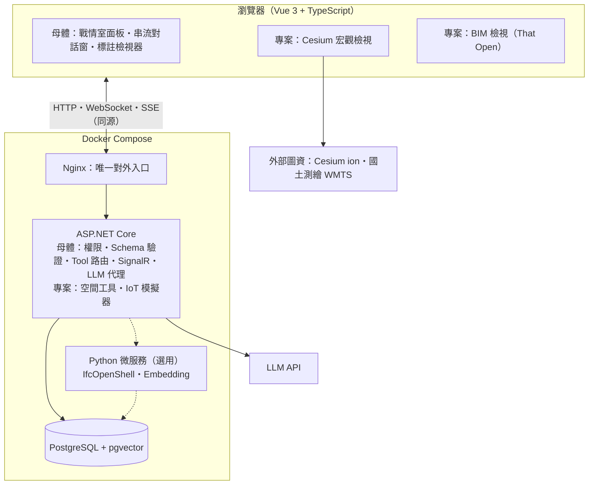
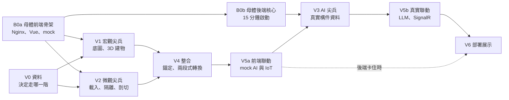

# 「AI 空間智慧數位雙生戰情室」可行性評估報告

Oct 15, 2026 · @Rocky

> 第 2 版：加入「共用母體架構」、改為個人開發定位（移除商業考量）、新增「降級階梯」應對策略；示範模型不再限定含配電箱。
>
> 2026-10-15 補充：實作改為「極簡 MVP 先行」，5 個 Stage 的清單見 [spatial-twin-guard 實作進度.md](spatial-twin-guard%20實作進度.md)。本報告的共用母體（第 0 節）與驗證關卡（第 5 節），改作 MVP 完成後擴充時的參考；MVP 的實際範圍以清單為準。

## 結論摘要

**可行。以個人開發定位，第一個專案（含共用母體核心）單人約 38–55 人日（全職約 8–11 週）。** 其中母體核心 11–17 人日，之後每個 POC 都能沿用；專案本身 27–38 人日。技術元件都是成熟的開源專案，沒有做不到的環節。難點仍是 Cesium 與 Three.js 的銜接，以及 AI 指令能否穩定對應到 IFC 構件。

動工前建議先做四項調整：

1. **母體分兩批做。** 本專案用得到的核心（Nginx、Vue 外殼與串流對話窗、ASP.NET Core 工具路由、PostgreSQL + pgvector）先做。PDF/圖片標註、權限等本專案用不到的模組，延到第一個需要它的專案前再補。
2. **IFC 引擎改用 That Open Engine（`@thatopen/components`）。** 規格指定的 `web-ifc-three` 與 `ifcManager.getItemProperties()` 屬於已停止維護的舊版 IFC.js。
3. **「從全島穿透進入建築」改為兩段式：** Cesium 飛到建築上空，再淡入切換到 Three.js BIM 檢視。同畫面深度融合留作限時嘗試的加分項。
4. **LLM 呼叫走母體後端的工具路由，並補查詢類工具**（例如 `findElements`），讓模型先查出目標構件在哪一層，再呼叫剖切。

改為個人開發後，授權風險全部退場。示範模型也不再限定含配電箱，能呈現數位雙生效果的建築或設施都可以用，資料不再是瓶頸。最大的風險變成母體架構拖慢主專案開工，對策是分兩批並限時；其餘風險依「先試、再模擬、再替代、最後移除」的降級階梯（第 3 節）處理，不會卡住專案。規格書在 Phase 2 第 2 點中斷，IoT 與部署的驗收條件由本報告第 5 節補上。

## 0. 共用母體架構（Base Boilerplate）

**可行，建議分兩批：核心約 11–17 人日，第二批約 7–11 人日。** 母體的投資要到第二個專案才回收。本專案是它唯一的試用者，沒被用到的模組最容易設計錯，所以只先做本專案實際用得到的部分。核心再依「前端先行」拆成兩段：B0a 前端骨架先做，B0b 後端核心等需要真實資料與 AI 時才做（第 5 節）。

實線為核心，虛線為選用。瀏覽器直接讀取外部圖資；其餘請求都經 Nginx 同源轉發，LLM 金鑰只存在後端。

| 元件 | 本專案用途 | 批次 | 估計（人日） | 技術重點 |
| --- | --- | --- | --- | --- |
| Docker Compose + Nginx | 唯一對外入口 | 核心 | 1–2 | WebSocket 升級；SSE 路徑要設 `proxy_buffering off`，否則串流會變成一次吐完；`.wasm` MIME；SPA 路由回退；每個容器都有 healthcheck |
| Vue 3 外殼與戰情室面板框架 | 放 Cesium、BIM、感測器面板 | 核心 | 2–3 | 面板以動態元件註冊，專案只寫面板內容；版面可存成設定 |
| 串流對話窗 | AI 空間指令 | 核心 | 2–3 | SSE 串流、Markdown 顯示、工具呼叫卡片（顯示模型呼叫了哪個工具與參數） |
| ASP.NET Core：LLM 供應商抽象、Tool 路由、Schema 驗證 | 空間工具的定義、驗證與派送 | 核心 | 3–4 | 工具參數用 C# record 定義，以 .NET 9 起內建的 `JsonSchemaExporter` 產生 Schema，執行前先驗證；工具分「後端執行」與「交給前端執行」兩類；模型名稱放設定檔 |
| SignalR 基底 | IoT 推播、前端回報工具執行結果 | 核心 | 1 | 自動重連、強型別 Hub |
| PostgreSQL + pgvector | 構件索引、感測歷史；備案的語意比對 | 核心 | 1–2 | 用 `pgvector/pgvector` 映像；EF Core migration 在啟動時自動套用 |
| 新專案腳手架 | 達成 15 分鐘啟動 | 核心 | 1–2 | 一支腳本改專案名稱、埠號、資料庫名稱；附 `.env.example` |
| 權限（JWT、角色） | 單人展示可不用 | 第二批 | 2–3 | 先留介面，預設關閉 |
| PDF/圖片標註檢視器 | 本專案不用 | 第二批 | 3–5 | pdf.js 加標註層；標註存 PostgreSQL |
| Python 微服務骨架 | 選用：IfcOpenShell 解析 IFC、跑本地 Embedding 模型 | 第二批 | 1 | 用 Compose `profiles` 設為預設不啟動 |
| 中文全文檢索 | 選用：構件與文件搜尋 | 第二批 | 1–2 | PostgreSQL 內建全文檢索不會斷中文詞，需 zhparser 或 pg_jieba 擴充（要自建映像）；PoC 規模可先用 `pg_trgm` |

**「15 分鐘啟動」的驗收定義。** 前提是已裝 Docker Desktop、基底映像已拉取（首次下載不計）。從複製範本開始計時，以下五項全部通過即達標：

1. `docker compose up -d` 後，所有容器的 healthcheck 為 healthy。
2. 瀏覽器開啟首頁，戰情室面板顯示範例資料。
3. 對話窗送出一句話，看到串流回覆，並觸發一次範例工具呼叫。
4. 後端推送一則 SignalR 測試訊息，前端收到。
5. 資料庫 migration 完成，`vector` 擴充可用。

**母體對本專案的直接好處：** 構件索引存進 PostgreSQL 後，`findElements` 可以在後端查詢。若中文說法（例如「會議室」）對不到英文或其他語言的構件名稱，可改用 pgvector 做跨語言語意比對。Embedding 模型另選：雲端 API，或在 Python 微服務跑開源多語模型（例如 bge-m3）。

## 1. 技術可行性

**七個模組中，四個可直接做、兩個需換套件或補設計、一個有條件可行。** 沒有技術上做不到的模組；「有條件」的是宏觀到微觀的無縫轉換。CesiumJS（Apache-2.0）、Three.js（MIT）、web-ifc（MPL-2.0）、That Open Components（MIT）都是開源授權，個人開發沒有授權費；唯一的持續成本是 LLM API 用量。

| 模組 | 判定 | 依據 | 需要注意的地方 |
| --- | --- | --- | --- |
| Cesium 宏觀場景（底圖、3D Tiles、著色與拾取） | 可行 | `Cesium3DTileStyle`、`scene.pick` 都是內建功能；國土測繪圖資的 WMTS 可用 `WebMapTileServiceImageryProvider` 直接接。 | Cesium OSM Buildings 需要 Cesium ion token；免費方案個人使用可用，每月串流額度 15 GB。Vite 整合建議用 [Cesium 官方寫法](https://cesium.com/blog/2024/02/13/configuring-vite-or-webpack-for-cesiumjs)（`vite-plugin-static-copy` + `CESIUM_BASE_URL`），`vite-plugin-cesium` 對新版 Vite 的支援未確認。 |
| 瀏覽器端 IFC 解析（web-ifc WASM） | 可行，需換套件 | web-ifc 仍在維護；[web-ifc-three 的 README](https://github.com/ThatOpen/web-ifc-three) 寫明「THIS LIBRARY IS DEPRECATED」。 | 改用 `@thatopen/components`，它內建分類、隱藏、剖切、高亮元件，正好對應 AI 的三個動作。大型模型在瀏覽器內轉換很慢，建議預先轉成 Fragments 檔再載入。 |
| 座標融合（ENU 錨定） | 可行 | `Transforms.eastNorthUpToFixedFrame` 可產生把模型放到指定經緯度的矩陣。 | Three.js 若直接用地心座標（ECEF），Float32 精度不足會造成模型抖動，必須以建築原點為中心計算。多數 IFC 沒有可用的地理參考（`IfcMapConversion`），錨點與方位角要人工定。 |
| 宏觀→微觀視角轉換 | 有條件可行 | 兩引擎各自有 WebGL context 與深度緩衝，同畫面疊合時遮擋關係會錯，相機同步要自己寫。 | 兩段式（Cesium 飛行後淡入切換到 Three.js）穩定可行。若堅持同畫面，較穩的做法是把 IFC 轉成 glTF 放進 Cesium 顯示外殼，進入室內再切換。 |
| AI 空間語意操控（Function Calling） | 可行，需補設計 | Claude 與 Gemini 的 API 都支援工具呼叫。 | 規格指定的 Claude 3.5 Haiku 已於 2026-02-19 [退役](https://platform.claude.com/docs/en/about-claude/model-deprecations)；三個工具都是「動作」，沒有「查詢」，模型無從得知目標構件的 ID 與樓層。LLM 呼叫走母體的後端 Tool 路由，金鑰不進前端。 |
| IoT 模擬與 SignalR 推播 | 可行 | ASP.NET Core 的 `BackgroundService` 產生資料、`IHubContext` 推播，是標準寫法。 | 感測器與 IFC 構件（`GlobalId`）的對照表要自己定。規格書這部分內容缺漏。 |
| Docker Compose + Nginx 反向代理 | 可行 | 單一對外入口、同源免 CORS 的設計正確，已併入共用母體（第 0 節）。 | .NET 8 起容器預設埠是 [8080](https://learn.microsoft.com/en-us/dotnet/core/compatibility/containers/8.0/aspnet-port)，不是規格寫的 5000。`/hub/` 需設 `proxy_http_version 1.1` 與 `Upgrade`、`Connection` 標頭。官方 nginx 映像不含 Brotli 模組。 |

## 2. 難易度分級

**第一個專案約 38–55 人日（全職約 8–11 週）：母體核心 11–17 人日（見第 0 節），專案本身 27–38 人日。** 採兩段式轉換時，專案本身沒有 L4 項目；同畫面無縫穿透若要做，另加 8–15 人日且可能失敗。估算前提：一位熟悉 Vue 與 .NET、但未用過 Cesium 與 IFC 的開發者。

分級定義：**L1** 照官方範例可完成；**L2** 需整合多個套件並調參；**L3** 沒有現成範例，需自行研究與反覆實驗；**L4** 可能做不出來，必須備案。

| 工作項目 | 等級 | 估計（人日） | 難在哪裡 |
| --- | --- | --- | --- |
| 同畫面無縫穿透（加分項，限時 3 天嘗試） | L4 | 8–15 | 兩引擎深度緩衝不共用、相機矩陣與精度同步、兩個 WebGL context 的效能 |
| 中文語意對應 IFC 類別與準確率調校 | L3 | 3–5 | 中文說法（例如「會議室」）要對到 IFC 類別，還要應付模型內命名不一致；需建同義詞表與測試題庫 |
| 效能調校（大型模型、幀率） | L3 | 3–5 | 要在筆電內顯上達到驗收幀率，可能需要 LOD、預轉檔、Web Worker |
| IFC 載入與點選屬性（That Open） | L2 | 3–4 | 新版 API 與網路上多數舊教學不同；WASM 路徑與 Three.js 版本要對齊 |
| 分類隔離、樓層剖切、高亮 | L2 | 3–4 | 剖切高度要從 `IfcBuildingStorey` 標高推算，各模型資料品質不一 |
| 兩段式宏觀→微觀轉換 | L2 | 3 | 飛行終點與 Three.js 初始視角要對齊，淡入淡出不閃畫面 |
| 空間工具定義與前端執行器 | L2 | 2–3 | 工具路由與多輪迴圈由母體提供；本專案寫 `findElements`、`sliceFloor` 等工具，並把前端執行結果回傳給模型 |
| 台灣底圖與 3D 建物載入、著色、拾取 | L2 | 2–3 | Cesium OSM Buildings 可直接用；難在示範地點的覆蓋度與底圖對位 |
| 座標錨定與方位角校正 | L2 | 2–3 | IFC 缺地理參考時要人工對位，與底圖建物輪廓對齊 |
| IoT 模擬、SignalR 推播與構件著色 | L1–L2 | 2–3 | 對照表設計；推播頻率太高時前端重繪負擔 |
| 展示包裝（UI 打磨、錄影腳本、README） | L1 | 2–3 | 工作量不大但常被低估，對作品集效果影響最大 |
| Cesium 整合進母體前端 | L1 | 1 | Cesium 靜態資源路徑；Viewer 用 `shallowRef` 或非響應式變數 |
| Nginx 補 WASM 與靜態圖資設定 | L1 | 0.5–1 | `.wasm` MIME、IFC／Fragments／3D Tiles 的快取標頭 |

若走到降級階梯的 pgvector 語意比對（第 3 節第 4 列 ③），另加 2–3 人日。

## 3. 風險及未知數

**改為個人開發定位、示範模型也不限定含配電箱之後，授權與資料風險都降低；最大的風險變成母體架構拖慢主專案開工。** 對策是分兩批並限時。表中「已發生」表示已查證為事實。

| 風險 | 類別 | 可能性 | 影響 | 對策 |
| --- | --- | --- | --- | --- |
| 母體架構範圍膨脹，主專案遲遲無法開工。 | 範疇 | 中 | 高 | 分兩批；核心限時 17 人日，超過就砍到剛好夠本專案用。 |
| 母體只有本專案一個使用者，抽象可能不適用下一個領域。 | 架構 | 中 | 中 | 只抽出本專案真正用到的部分；第二個專案啟動時再重構。 |
| 規格指定的 LLM 模型過時。Claude 3.5 Haiku 已退役；[Google 文件](https://ai.google.dev/gemini-api/docs/deprecations)表示 Gemini 2.5 Flash 未棄用，但建議新專案改用 3.x 模型。 | 技術 | 已發生 | 中 | 模型名稱放後端設定檔，工具綱要保持供應商中立；改用現行模型，例如 `claude-haiku-5-5`。 |
| AI 選錯構件或樓層，示範時當場出錯。 | AI 可靠度 | 中 | 中 | 降級階梯第 4 列；示範影片用已驗證的句子。 |
| 雙引擎轉換效果不如預期（閃畫面、對不準）。 | 技術 | 中 | 中 | 降級階梯第 3 列。 |
| 瀏覽器效能不足（大型 IFC 加兩個 WebGL context）。 | 效能 | 中 | 中 | 降級階梯第 6 列；先訂定驗收機型。 |
| 串流對話被 Nginx 緩衝，回覆變成一次吐完。 | 技術 | 高（未設定時） | 低 | SSE 路徑設 `proxy_buffering off`。 |
| PostgreSQL 內建全文檢索不會斷中文詞。 | 技術 | 已發生 | 低 | 降級階梯第 8 列。 |
| C# 與 Python 兩套後端增加維護負擔。 | 維護 | 中 | 低 | Python 只在需要其生態（IfcOpenShell、本地模型）時啟用，預設關閉。 |
| 個人 LLM 預算超支、金鑰外洩。 | 成本與安全 | 低 | 中 | 主控台設每月上限；金鑰只在後端；公開展示版加速率限制。 |
| 示範模型缺少數位雙生需要的內容，例如樓層資訊不完整，或沒有可掛感測器的空間、設備。 | 資料 | 低 | 中 | 不限定建築類型或構件，候選來源大幅放寬，[Schependomlaan](https://github.com/PlumpMath/DataSetSchependomlaan) 也重新列入候選；條件差一點就用 Bonsai 補（降級階梯第 1 列）。 |
| 套件版本衝突（That Open 與 Three.js、Cesium 與 Vite）。 | 技術 | 中 | 低 | 一開始就鎖定版本，以 That Open 要求的 Three.js 版本為準。 |
| 規格書不完整。Phase 2 在第 2 點中斷，IoT 與部署沒有里程碑與驗收條件。 | 範疇 | 已發生 | 中 | 先補上本報告第 5 節的驗收標準，再開工。 |

第 1 版列出的兩項授權風險已移除：Schependomlaan 僅授權學術使用、Cesium ion 免費方案限非商業用途，都不影響個人開發。公開展示時，仍建議在畫面註明模型與圖資來源。

### 降級階梯：先試、再模擬、再替代、最後移除

**每個高風險項目都先試原方案；超過限時或驗收不過，就往下一階，不回頭。** 限時取第 2 節的估計上限，同畫面穿透另訂 3 天。每降一階，在 README 的「已知取捨」記一行；作品集展示時，這份取捨紀錄本身就能展現判斷力。AI 指令與 3D 檢視是本專案核心，只降級、不移除。

| # | 項目 | ① 原方案 | ② 模擬／假資料 | ③ 替代方案 | ④ 移除後的樣子 |
| --- | --- | --- | --- | --- | --- |
| 1 | 能呈現數位雙生效果的 IFC 模型 | 找現成的建築或設施模型：有樓層，也有可掛感測器的空間或設備 | 用 Bonsai 補上缺的空間、設備或屬性 | 改用其他開源範例模型 | 示範句改用模型既有構件（例如「帶我看樓梯」），感測器改掛在樓層上 |
| 2 | 台灣 3D 建物 | Cesium OSM Buildings | 在示範地點周邊手工擠出少量建物塊體 | 國土測繪中心三維建物（若可取得），或 OSM 輪廓批次擠出 | 只留底圖與單棟 BIM |
| 3 | 宏觀→微觀轉換 | 兩段式淡入切換（同畫面穿透限時 3 天嘗試） | — | 硬切換，不淡入 | 兩個獨立頁面，用按鈕切換 |
| 4 | 中文 AI 指令 | 自然語言加多輪工具迴圈 | 提示注入樓層與類別清單、同義詞表 | pgvector 跨語言語意比對 | 固定句型加快捷按鈕（核心項目，不完全移除） |
| 5 | IoT 感測資料 | 模擬器即時產生 | 預錄一段數據循環重播 | — | 只顯示靜態告警顏色 |
| 6 | 大型模型效能 | 目標模型直接載入 | — | 預轉 Fragments、拆樓層按需載入 | 換較小的範例模型 |
| 7 | 座標錨定 | 讀 IFC 的 `IfcMapConversion` | 人工輸入經緯度與方位角 | — | 放在空地，不對齊底圖建物 |
| 8 | 中文全文檢索 | zhparser 或 pg_jieba 自建映像 | — | `pg_trgm` 或 `ILIKE` | 只用向量檢索 |
| 9 | 母體第二批模組 | 開工前做完 | — | 延到第一個需要它的專案 | 本專案不做 |

**尚未查證、需要實測的未知數：**

- Cesium OSM Buildings 在示範地點的建物覆蓋完整度。
- `vite-plugin-cesium` 是否支援目前的 Vite 版本。
- 目標 IFC 模型在瀏覽器內的載入時間與記憶體用量。
- 首次建置映像（`npm install`、`dotnet restore`）時，15 分鐘啟動是否仍做得到。
- `pg_trgm` 對中文構件名稱的搜尋效果。

## 4. 前置資源

**開工前最關鍵的是一份能呈現數位雙生效果的 IFC 模型；不限建築類型，條件差一點就用 Bonsai 補，不必等。** 除 LLM API 外，所有資源都可免費取得。後端版本建議改用 .NET 10：規格寫的 [.NET 8 與 .NET 9 都在 2026-11-10 結束支援](https://dotnet.microsoft.com/en-us/platform/support/policy/dotnet-core)，.NET 10 LTS 支援到 2028-11-14。

**資料**

- [ ] **能呈現數位雙生效果的 IFC 模型**：建築或設施皆可，IFC2x3 或 IFC4；2 層以上、`IfcBuildingStorey` 完整，並有可掛感測器的空間（`IfcSpace`）或設備。條件差一點就用 Bonsai 補。已實測的候選：[KIT](https://www.ifcwiki.org/index.php?title=KIT_IFC_Examples) 的 `AC20-Institute-Var-2.ifc`（IFC4、5 層、82 個空間），細節見[完整版實作清單](spatial-twin-guard%20實作進度（完整版）.md) V0。
- [ ] **建築錨點**：經緯度、地面高程、方位角，從底圖量測。
- [ ] **示範地點的 3D 建物**：先在 Cesium OSM Buildings 目視確認覆蓋度；不足時見降級階梯第 2 列。
- [ ] **國土測繪圖資 WMTS 圖層清單**：選定底圖圖層，確認引用標示。
- [ ] **感測器模擬清單**：感測器 ID 對應 IFC `GlobalId`、數值範圍、告警門檻。
- [ ] **AI 測試題庫**：30 句以上的中文指令與預期工具呼叫，用於驗收。

**帳號與金鑰**

- [ ] **LLM API 金鑰**（Anthropic 或 Google），在主控台設定每月用量上限。
- [ ] **Cesium ion 帳號**：免費 Community 方案，個人用途可用；用於 OSM Buildings 與 World Terrain。
- [ ] **Embedding 來源**（選用）：雲端 API 或本地開源模型；走到降級階梯第 4 列 ③ 才需要。

**母體架構**

- [ ] **母體範本 repo**：設為 GitHub template repository，附新專案腳本與 `.env.example`。
- [ ] **映像清單**：nginx、.NET 10 SDK 與 runtime、Node.js LTS、`pgvector/pgvector`，Python 選用；先拉取到本機，以符合 15 分鐘啟動的前提。

**硬體與環境**

- [ ] **驗收基準機**：明定 CPU、GPU、記憶體規格；建議一台獨顯開發機，另加一台內顯筆電作為最低標準。
- [ ] **Docker Desktop（WSL 2）**、Node.js LTS、.NET 10 SDK。

**工具**

- [ ] **IfcOpenShell / Bonsai**：檢查、修改 IFC，補上缺的空間或設備，必要時轉成 glTF。
- [ ] **任一桌面 IFC 檢視器**：開工前先確認模型裡有哪些類別與樓層。

**技能（需要補強的部分）**

- Cesium 座標系（ECEF、ENU）與相機控制。
- IFC 資料結構：空間階層、類別、屬性集。
- LLM 工具呼叫的多輪迴圈與提示設計。
- PostgreSQL + pgvector：向量欄位、索引與相似度查詢。
- Nginx 反向代理、WebSocket 與 SSE 設定。

## 5. 驗證順序及驗收標準

**前端先行：先搭母體前端骨架（B0a）並定好資料（V0），前端各關全部用 mock 資料完成；需要真實資料與 AI 時，才做母體後端（B0b）並接上 AI（V3）。** 改為降級策略後，沒有任何關卡會讓全案停工；不過關就往下一階。V5a 完成時已經有可展示的版本，後端階段卡住也能直接部署。下表數字為建議值，應在 V0 定完驗收基準機後確認。逐項工作與工時見[完整版實作清單](spatial-twin-guard%20實作進度（完整版）.md)；目前實作先走極簡 MVP（[實作進度清單](spatial-twin-guard%20實作進度.md)）。

V1、V2 建在母體前端骨架上，要等 B0a 與 V0；V3 要用 V5a 的前端執行器與 V2 匯出的真實構件索引，所以排在 B0b 與 V5a 之後。虛線表示後端階段卡住時，直接用 V5a 的版本部署。

| 關卡 | 驗證內容 | 驗收標準（建議值） | 不過關時 |
| --- | --- | --- | --- |
| B0a 母體前端骨架 | Nginx（只放前端）、Vue 外殼與戰情室面板、mock 資料層（MSW） | 開發模式與經 Nginx 打包後，面板都顯示 mock 資料；子路由重新整理不 404 | 超過 6 人日：先固定版面，只留本專案用得到的部分 |
| V0 資料 | IFC 模型內容、建築錨點、驗收基準機、OSM Buildings 覆蓋度 | 示範句的目標構件已選定，且在桌面檢視器查得到所屬樓層（或已決定走降級階梯哪一階）；錨點經緯度與方位角已定 | 降級階梯第 1、2 列往下一階 |
| V1 宏觀尖兵 | 國土測繪 WMTS 底圖、3D 建物載入、依高度著色、點選高亮 | 基準機 1080p 平移縮放 ≥ 30 FPS；點選後 300 ms 內高亮並顯示屬性 | 降級階梯第 2 列 |
| V2 微觀尖兵 | That Open 載入、點選屬性、類別隔離、樓層剖切 | 目標模型首次載入 ≤ 15 秒（預轉 Fragments 後 ≤ 5 秒）；點選顯示 ExpressID、名稱、類別 ≤ 500 ms；每一層剖切結果與樓層表一致 | 降級階梯第 6 列 |
| V4 整合 | 座標錨定、兩段式宏觀→微觀轉換 | IFC 外輪廓與底圖建物偏差 ≤ 2 公尺；飛行到切換完成 ≤ 5 秒，無黑畫面；來回切換 10 次後記憶體增加 < 10% | 降級階梯第 3、7 列 |
| V5a 前端聯動 | 串流對話窗、前端執行器、IoT 前端著色；AI 與感測數據都用 mock | 示範句（固定句型）串流顯示，相機到位並完成剖切；50 個模擬感測器每秒更新一次時 FPS 仍 ≥ 30 | 動用效能調校，或降低更新頻率 |
| B0b 母體後端核心 | PostgreSQL + pgvector（Docker）、SignalR、LLM 抽象與 Tool 路由、Nginx 轉發、抽出範本與腳手架 | 符合第 0 節「15 分鐘啟動」的五項驗收 | 超過 9 人日：砍到剛好夠本專案用，其餘移到第二批；整段卡住就用 V5a 的版本部署 |
| V3 AI 尖兵 | 母體 Tool 路由加空間工具、多輪工具迴圈（用 V2 匯出的真實構件索引） | 30 題測試集中，工具與參數全對 ≥ 27 題；示範句連跑 10 次全部成功；回應時間中位數 ≤ 4 秒 | 24–26 題算降級過關；低於 24 題走降級階梯第 4 列往下一階，④ 直接沿用 V5a 的固定句型 |
| V5b 真實聯動 | AI 指令驅動真實 3D 動作；IoT 改由後端模擬，經 SignalR 推播 | 示範句從送出到相機到位、剖切完成 ≤ 6 秒；50 個感測器每秒經 SignalR 更新一次時 FPS 仍 ≥ 30；後端重啟後 10 秒內自動重連 | 降低推播頻率；仍不足走降級階梯第 5 列，改回前端模擬數據 |
| V6 部署與展示 | Docker Compose 一鍵啟動、Nginx 設定、展示影片 | 乾淨機器上 `docker compose up -d` 一次啟動；`.wasm` 回應標頭為 `application/wasm`；`/hub/` 回應 101 升級；串流對話在 Nginx 後仍逐字顯示；主控台 0 個 CORS 錯誤；前端打包產物搜不到 API 金鑰 | 修正設定，不該有結構性問題 |

## 6. 評估後沒把握的三件事

**以下三件事我無法靠查資料確認，只能靠第 5 節的關卡實測。** 降級階梯能確保專案完成，但這三件事決定完成時的樣子與花多久。

1. **中文指令能不能穩定對到正確的構件。** 準確率取決於模型裡構件的命名品質（常是英文或內部編碼），而不是 LLM 本身。我設的 30 題對 27 題是目標值，沒有實測數據支持。由 V3 驗證；若達不到，先加 pgvector 語意比對，仍不足再縮小為固定句型加快捷按鈕。
2. **母體架構的抽象是否選對。** 母體是為之後所有 POC 設計的，但目前只有本專案能驗證它。戰情室面板與 Tool 路由的介面，可能到第二個領域（例如文件標註類專案）才發現不合用；PDF/圖片標註則完全沒有本專案可驗證。由 B0a、B0b 與第二個專案驗證；建議預期第一版母體會重構一次。
3. **38–55 人日的工時估算。** 最大變數是 That Open 新版 API 的學習曲線、目標模型在瀏覽器內的效能，以及母體核心能否守住 17 人日。網路上多數教學仍是已停維護的 web-ifc-three 寫法，可參考的新版範例較少。由 B0a、B0b 與 V2 驗證；V2 若超過 10 人日（估計為 6–8 人日），應重估全案。

## 附錄：規格書建議修正處

**規格書有 11 處建議在開工前修正，其中 4 處不改會直接卡住開發。** 卡住開發的是：LLM 模型、IFC 套件、後端埠號、工具綱要。

| 規格書原文 | 問題 | 建議改為 |
| --- | --- | --- |
| 「Gemini 2.5 Flash / Claude 3.5 Haiku」 | Claude 3.5 Haiku 已於 2026-02-19 退役，呼叫會失敗；Gemini 2.5 Flash 非 Google 建議的新專案模型 | 模型名稱放設定檔；例如 `claude-haiku-5-5`，或 Google 文件建議的 3.x Flash |
| 「web-ifc-three」、「`ifcManager.getItemProperties()`」 | 套件已停止維護 | `@thatopen/components`（IFC 載入、分類、剖切、高亮） |
| 「`/api/` → `http://backend:5000/api/`」 | .NET 8 起容器預設埠是 8080 | 改成 8080，或設定 `ASPNETCORE_HTTP_PORTS=5000` |
| 工具綱要只有 `flyToLocation`、`isolateElement`、`sliceFloor` | 沒有查詢工具，模型不知道目標構件在哪一層，示範句無法完成 | 新增 `findElements(category, floor?)`（回傳 GlobalId 與所屬樓層）與 `listFloors()`，定義在母體的 Tool 路由，並把執行結果回傳給模型 |
| 未說明 LLM 從哪一端呼叫 | 從前端呼叫會暴露 API 金鑰 | 由母體後端的 Tool 路由代理（例如 `POST /api/agent`），並加速率限制 |
| 「ASP.NET Core 8.0/9.0」 | 兩者都在 2026-11-10 結束支援 | .NET 10 LTS |
| 示範句「請帶我看配電箱位置，並幫我剖切到該樓層。」 | 範例模型 Schependomlaan 沒有電氣構件，照原句示範不出來 | 示範句的目標依選定的模型決定，例如「請帶我看〈會議室〉，並幫我剖切到該樓層。」；模型不必含配電箱 |
| 只定義 `frontend`、`backend` 兩個容器 | 與共用母體不一致，缺資料層 | 改用共用母體：加入 PostgreSQL + pgvector，Python 微服務選用 |
| 「`vite-plugin-cesium`」 | 對新版 Vite 的支援未確認 | Cesium 官方寫法：複製靜態資源 + `define` 設定 `CESIUM_BASE_URL` |
| 「Gzip/Brotli 快取」 | 官方 nginx 映像不含 Brotli 模組 | 先只用 gzip（`gzip_types` 加入 `application/wasm`）；需要 Brotli 時改用含該模組的映像 |
| Phase 2 第 2 點中斷，沒有後續階段 | IoT 與部署沒有里程碑與驗收條件 | 補上後續階段，驗收標準可採用第 5 節 |

## 資料來源

以下為本報告實際查閱的頁面，查閱日期 2026-10-15。

- [Anthropic：Model deprecations](https://platform.claude.com/docs/en/about-claude/model-deprecations)
- [Google：Gemini API deprecations](https://ai.google.dev/gemini-api/docs/deprecations)
- [ThatOpen/web-ifc-three（GitHub）](https://github.com/ThatOpen/web-ifc-three)
- [Cesium ion Pricing](https://cesium.com/platform/cesium-ion/pricing/)
- [Cesium：Configuring Vite or Webpack for CesiumJS](https://cesium.com/blog/2024/02/13/configuring-vite-or-webpack-for-cesiumjs)
- [Microsoft：Default ASP.NET Core port changed from 80 to 8080](https://learn.microsoft.com/en-us/dotnet/core/compatibility/containers/8.0/aspnet-port)
- [Microsoft：.NET support policy](https://dotnet.microsoft.com/en-us/platform/support/policy/dotnet-core)
- [DataSetSchependomlaan（GitHub）](https://github.com/PlumpMath/DataSetSchependomlaan)
- [KIT IFC Examples（ifcwiki.org）](https://www.ifcwiki.org/index.php?title=KIT_IFC_Examples)：兩個模型的樓層與空間數量，是下載檔案後直接清點的結果

第 2 版新增的母體架構技術細節（`pgvector/pgvector` 映像、`JsonSchemaExporter`、Compose `profiles`、Nginx SSE 緩衝、中文斷詞擴充）依既有知識撰寫，本次未重新查證。
